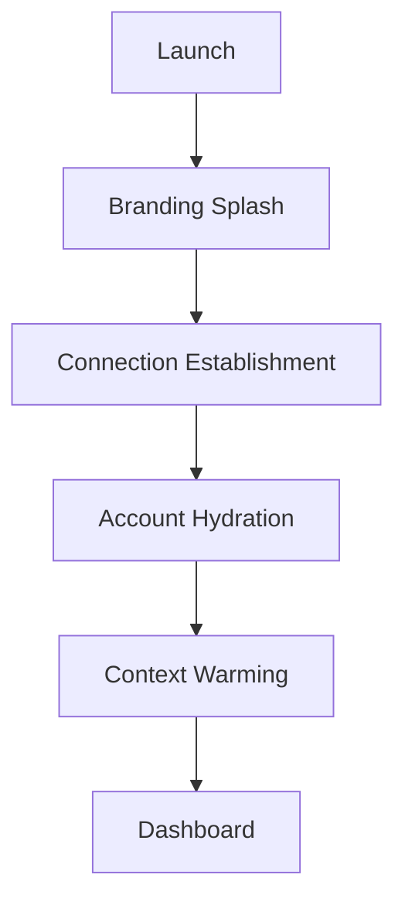

# SanibonaniSave — Design Specification

This document details the visual identity, UI architecture, and design principles of the SanibonaniSave platform.

---

## 🎨 1. Visual Identity

### Brand Essence
SanibonaniSave is built on **trust, transparency, and professional cooperative finance**. The design balances South African communal warmth with high-integrity financial utility.

### Color Palette
The app uses a **warm emerald "Navy"** base with **teal** and **South African warm gold / terracotta** accents — community warmth carried into a fintech palette. Values below are the constants in `ui/theme/Color.kt`.

| Category | Name | HEX | Usage |
|----------|------|-----|-------|
| **Brand** | Navy | `#0F3A2F` | Primary Brand Color (deep warm emerald) |
| **Brand** | Accent Blue | `#2DD4BF` | Primary Action/Link Accent (warm teal) |
| **Brand** | Warm Gold | `#D97706` | Secondary accent, positive prompts |
| **Brand** | Terracotta | `#C2410C` | Tertiary accent, sunset highlight |
| **Surface** | Cream | `#FAF8F5` | Light Mode Canvas (warm linen) |
| **Status** | Success | `#10B981` | Positive Financial Health |
| **Status** | Warning | `#F97316` | Action Required / Overdue |
| **Status** | Error | `#EF4444` | Critical Failures / Arrears |

> The Material error role itself is `#DC2626` (`md_theme_light_error`); `ErrorRed`
> `#EF4444` is the shared status constant used by cards and banners.

### Typography
- **Primary Font**: `Outfit` (Google Fonts, loaded through the Compose Google-Font provider — no bundled `res/font`).
- **Scale**: Material 3 Standard; `DisplayFont` and `BodyFont` are both `OutfitFontFamily`.
- **Key Styles**:
    - `Display Large`: Black weight (57sp) — splash and hero branding.
    - `Display Medium`: ExtraBold (45sp) — section heroes.
    - `Headline Small`: Bold for section titles.
    - `Body Large`: Normal for financial data and descriptions.
    - `Label Small`: SemiBold for metadata and status badges.

---

## 🏗️ 2. UI Architecture

### Component System
The app follows a **Material 3 (M3)** design system, customized for the South African context (ZAR formatting, communal terminology).

- **`AdaptiveScaffold`**: A custom wrapper that dynamically switches between `NavigationBar` (mobile), `NavigationRail` (tablets), and `NavigationDrawer` (large screens).
- **`SoftLoadingOverlay`**: Non-blocking visual feedback for background data synchronization.
- **`StatCard`**: Standardized component for displaying financial metrics (Savings, Interest, Shortfall).
- **`GroupIcon`**: Emoji-based identity system for quick group recognition.

### Modular Layouts
UI is organized into **Feature-Based Packages** under `com.sanibonani.save.features`:
- `landing`: Guest experience and value proposition.
- `auth`: High-security login and registration flows (biometric entry lives here).
- `common`: Splash/boot presentation and shared feature validation.
- `group`: Group creation, discovery, membership and rotation context.
- `member`: Personal savings portal and loan management.
- `admin`: Group-level administration, actuarial tools, payouts, and Platform Support Mode (impersonation).
- `audit`: The member/group/platform audit report tabs and their components.
- `kyc`: Identity and document capture plus verification states.
- `financial`: Payment gateways and sandbox testing.

---

## 🔄 3. Key User Flows

### The "Bootloader" Sequence
Ensures the app is fully hydrated before entering critical financial screens.

### Dashboard Experience
Both Member and Admin dashboards use a **Tabbed Horizontal Pager** system for deep exploration of group data without losing context.

---

## ⚖️ 4. Design Principles

### 1. Financial Precision
- **Eradicate `Double`**: All currency math and displays use the `Money` (BigDecimal) domain model.
- **Safe Ratios**: Percentage-based indicators (e.g., Solvency, Pot Progress) use `money.ratio(other)` to avoid floating-point drift.
- **ZAR Standard**: Standardized formatting `R1,234.56` across all screens.

### 2. Transparency First
- **The Ledger View**: Every transaction is visible as an immutable ledger entry.
- **Audit Trails**: Actions in "Support Mode" are explicitly flagged with high-visibility banners to maintain member privacy trust.

### 3. Resilience & Offline-First
- **Offline Banners**: Clear notification when the app is in offline mode.
- **Status Persistence**: Using linear and circular progress indicators to show sync progress, ensuring the user knows their data is being safely reconciled.

---

## 📱 5. Adaptive Strategy
The app is optimized for:
- **Portrait Mobile**: Primary target; optimized for one-handed operation.
- **Low-End Devices**: Minimal use of heavy animations; efficient Room-to-Compose data flow.
- **Rural Connectivity**: High-visibility offline indicators and retry mechanisms.

---
**Last Updated**: October 28, 2026
**Version**: 3.1 (Warm Palette Re-measured Against `ui/theme`)
