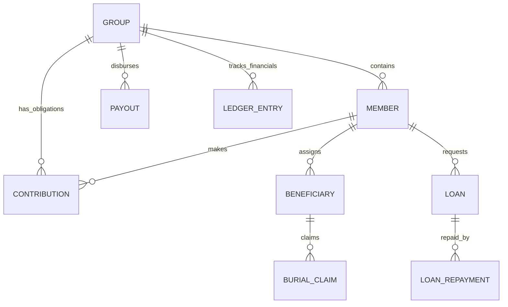

# 📊 Data Architecture & Synchronization Guide

This document provides a deep dive into the data layer of the SanibonaniSave application, covering domain models, database schema, relationships, and the offline-first synchronization strategy.

---

## 🏗 1. Core Data Structures (Domain Models)

The domain layer (`:domain`) defines the fundamental business entities. These models are pure Kotlin, annotated with `@Serializable` for network/disk transport and `@Parcelize` for UI navigation.

### Primary Entities:
- **`Group`**: The central container for all cooperative activities. Contains configuration (fees, probation, type) and financial state (balance).
- **`Member`**: Represents a person's relationship with a group. Tracks status (`ACTIVE`, `PROBATION`, `SUSPENDED`), joined date, and total contributions.
- **`Contribution`**: A specific financial obligation or payment (e.g., monthly fee, joining fee).
- **`LedgerEntry`**: The source of truth for all financial movements. Immutable records that adjust the group's balance.
- **`Loan` & `LoanRepayment`**: Lifecycle management for the "Smart Loan" feature.
- **`Beneficiary` & `BeneficiaryClaim`**: Identity and claim tracking for Burial Societies.

### Financial Models:
- **`ActuarialMetrics`**: Calculated scores and risk indicators for group health.
- **`PaymentCalculation`**: Transitional model used to compute fees, late penalties, and premiums before recording.

---

## 🗄 2. Database Schema (Room)

The local data layer (`:data`) mirrors the Supabase backend for offline capabilities.

### Table Mapping:
| Table Name | Entity Class | Primary Key | Main Indices |
|------------|--------------|-------------|--------------|
| `groups` | `GroupEntity` | `id` (UUID) | `admin_user_id`, `fee_status`, `is_public` |
| `members` | `MemberEntity` | `id` (UUID) | `group_id`, `user_id`, `member_key`, `status` |
| `contributions` | `ContributionEntity` | `id` (UUID) | `member_id`, `group_id`, `status`, `due_date` |
| `payouts` | `PayoutEntity` | `id` (UUID) | `group_id`, `status` |
| `burial_claims` | `BeneficiaryClaimEntity` | `id` (UUID) | `group_id`, `member_id`, `status` |
| `group_ledger` | `LedgerEntryEntity` | `id` (UUID) | `groupId`, `transactionId` |

### Complex Types (TypeConverters):
- **Enums**: Roles, Statuses, and Prefs are converted to/from Strings (using snake_case to match Supabase).
- **Booleans**: Stored as Integers (0/1) for SQLite compatibility.
- **Dates**: Stored as ISO-8601 Strings for consistent parsing across JVM and Postgres.

---

## 🔗 3. Entity Relationships

The system follows a relational hierarchy anchored by the `Group`.



### Key Relational Constraints:
- **Group → Member**: Many-to-many relationship via the `members` table (a user can be a member of multiple groups).
- **User → Profile**: One-to-one mapping via the Supabase Auth `uid`.
- **Ledger → Transaction**: Optional mapping. Not every ledger entry has a `transaction_id` (e.g., manual admin adjustments), but every payment transaction MUST have a `ledger_id`.

---

## 🔄 4. Synchronization (`observeAndSync`)

The application implements a "Local-First" pattern. The UI never waits for the network to render data.

### The Algorithm:
1.  **Emit Local**: The Repository returns a `Flow` that immediately emits whatever is in the Room DB.
2.  **Network Fetch**: Simultaneously, an asynchronous network request is made to Supabase.
3.  **Conflict Resolution**:
    *   On **Success**: The Repository calculates the difference between network and local data. It performs a "delta update" (upserting new/changed, deleting missing) in Room.
    *   On **Failure**: The error is captured and mapped to a user-friendly message, but the UI continues to show the cached data.
4.  **Real-time Push**: Repositories listen to Supabase Realtime (WebSockets). When a record changes on the server, the repo automatically triggers a fresh sync for that specific item.

### Example (BaseRepository.kt):
```kotlin
fun <T, E> observeAndSync(
    dbFlow: Flow<E>,
    mapper: (E) -> T,
    networkFetch: suspend () -> T,
    cacheSync: suspend (T) -> Unit
): Flow<Result<T>> = channelFlow {
    // 1. Observe DB
    launch {
        dbFlow.collect { entity ->
            send(Result.success(mapper(entity)))
        }
    }
    // 2. Sync from Network
    try {
        val remoteData = networkFetch()
        cacheSync(remoteData)
    } catch (e: Exception) {
        send(Result.failure(e))
    }
}
```

---

## 🛡 5. Data Integrity & Validation

### Backend Enforcement (Supabase RPCs):
Critical financial operations are performed via **Postgres Functions (RPCs)** to ensure atomicity.
- **`record_contribution_v1`**: Atomically creates a contribution, updates group balance, and creates a ledger entry. If any step fails, the whole transaction rolls back.

### Frontend Validation (`ValidationUtils`):
- **SA ID Number**: Validated via Luhn Algorithm.
- **Banking**: Regex-based validation for Account Numbers (7-13 digits) and Branch Codes (6 digits).
- **Currency**: Precision-safe math using `BigDecimal` equivalents before converting to `Double` for storage.

---

## 📂 6. Files & Locations

- **Models**: `domain/src/main/java/com/sanibonani/save/domain/model/`
- **Room Setup**: `data/src/main/java/com/sanibonani/save/data/local/`
- **Sync Core**: `data/src/main/java/com/sanibonani/save/data/repository/BaseRepository.kt`
- **Network Mapping**: `data/src/main/java/com/sanibonani/save/data/remote/PostgrestColumns.kt`
