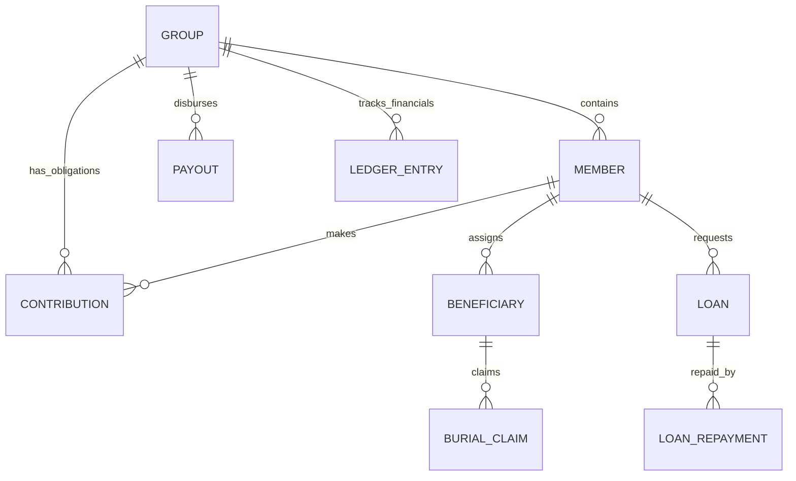

# 📊 Data Architecture & Synchronization Guide

This document provides a deep dive into the data layer of the SanibonaniSave application, covering domain models, database schema, relationships, and the offline-first synchronization strategy.

---

## 🏗 1. Core Data Structures (Domain Models)

The domain layer (`:domain`) defines the fundamental business entities. Models are
annotated `@Serializable` for network/disk transport only. They no longer carry
`@Parcelize`: `:domain` compiles with no `android.*` imports, navigation arguments
are ids, and each screen re-loads the model from Room. Session state crosses the
boundary as the domain-owned `AuthSession` / `AuthSessionStatus`, which `:data`
maps from the SDK types, and logging crosses through the `AppLogSink` port.

### Primary Entities:
- **`Group`**: The central container for all cooperative activities. Contains configuration (fees, probation, type) and financial state (balance).
- **`Member`**: Represents a person's relationship with a group. Tracks status (`ACTIVE`, `PROBATION`, `SUSPENDED`), joined date, and total contributions.
- **`Contribution`**: A specific financial obligation or payment (e.g., monthly fee, joining fee).
- **`LedgerEntry`**: The source of truth for all financial movements. Immutable records that adjust the group's balance.
- **`Loan` & `LoanRepayment`**: Lifecycle management for the "Smart Loan" feature.
- **`Beneficiary` & `BeneficiaryClaim`**: Identity and claim tracking for Burial Societies.

### Financial Models:
- **`ActuarialMetrics`**: Calculated scores and risk indicators for group health.
- **`PaymentCalculation`**: Transitional model used to compute fees, late penalties, and premiums before recording.

---

## 🗄 2. Database Schema (Room)

The local data layer (`:data`) mirrors the Supabase backend for offline capabilities.

### Table Mapping:
| Table Name | Entity Class | Primary Key | Main Indices |
|------------|--------------|-------------|--------------|
| `user_profiles` | `UserProfileEntity` | `id` (UUID) | `role`, `email` |
| `groups` | `GroupEntity` | `id` (UUID) | `admin_user_id`, `fee_status`, `is_public` |
| `members` | `MemberEntity` | `id` (UUID) | `group_id`, `user_id`, `member_key`, `status` |
| `contributions` | `ContributionEntity` | `id` (UUID) | `member_id`, `group_id`, `status`, `due_date` |
| `payouts` | `PayoutEntity` | `id` (UUID) | `group_id`, `status`, `member_id` |
| `beneficiaries` | `BeneficiaryEntity` | `id, group_id, member_id` | `group_id`, `member_id` |
| `beneficiary_payout_claims` | `BeneficiaryClaimEntity` | `id` (UUID) | `group_id`, `member_id`, `status` |
| `group_ledger` | `LedgerEntryEntity` | `id` (UUID) | `group_id`, `transaction_id`, `member_id` |
| `loans` | `LoanEntity` | `id` (UUID) | `member_id`, `group_id`, `status` |
| `loan_repayments` | `LoanRepaymentEntity` | `id` (UUID) | `loan_id`, `member_id` |
| `group_polls` | `GroupPollEntity` | `id` (UUID) | `group_id`, `status` |
| `bank_transactions` | `BankTransactionEntity` | `id` (UUID) | `group_id`, `bank_reference`, `status` |
| `member_behavior_track` | `MemberBehaviorTrackEntity` | `id` (UUID) | `member_id`, `group_id`, `fraud_risk_level` |
| `audit_logs` | `AuditLogEntity` | `id` (UUID) | `actor_id`, `target_group_id`, `action` |
| `pending_operations` | `PendingOperationEntity` | `id` (UUID) | `type`, `groupId`, `createdAt` |

### Complex Types (TypeConverters):
- **Enums**: Roles, Statuses, and Prefs are converted to/from Strings (using snake_case to match Supabase).
- **Booleans**: Stored as Integers (0/1) for SQLite compatibility.
- **Dates**: Stored as ISO-8601 Strings for consistent parsing across JVM and Postgres.

### Status casing
The Postgres CHECK constraints all use **lowercase snake_case** literals — `active`, `pending_payment`, `paid`, `due`, `overdue`, `partial`, `missed`, `partially_paid`, `group_approved`, `pending`/`verified`/`rejected`. Kotlin enum constants are UPPERCASE and reach the wire through `@SerialName`, so `MemberStatus.ACTIVE` posts `"active"`. Two columns deliberately break the pattern and are uppercase in the database: `audit_logs.action` (`POLL_CREATED`, `VOTE_CAST`, …) and `fraud_detection_events.severity` (`LOW`/`MEDIUM`/`HIGH`/`CRITICAL`), the latter despite `member_behavior_track.fraud_risk_level` being lowercase.

### Tables that are not full mirrors
`member_behavior_track`, `behavior_analytics_summary` and `fraud_detection_events` have no upload path — nothing writes them back to Supabase, and the local `member_behavior_track.id` primary key has no counterpart column in Postgres (whose PK there is `member_id`). Treat the local copies as on-device ML feature storage. `DYNAMICS` sync does read behavior rows down, but it currently requests the table `member_behavior_tracks` (plural) while every SQL master defines `member_behavior_track` (singular), so that read 404s and is swallowed by `safeRunCatching` — a known defect, not a design choice.

> The local `user_profiles` table is the Room name for the remote **`profiles`** table; `user_profiles` does not exist in Postgres. `members.user_id` references `auth.users(id)` directly.

---

## 🔗 3. Entity Relationships

The system follows a relational hierarchy anchored by the `Group`.



### Key Relational Constraints:
- **Group → Member**: Many-to-many relationship via the `members` table (a user can be a member of multiple groups).
- **User → Profile**: One-to-one mapping via the Supabase Auth `uid`.
- **Ledger → Transaction**: Optional mapping. Not every ledger entry has a `transaction_id` (e.g., manual admin adjustments), but every payment transaction MUST have a `ledger_id`.

---

## 🔄 4. Synchronization (`observeAndSync` & Outbox)

The application implements a "Local-First" pattern with an **Offline Outbox** for network resilience.

### Read Path (`observeAndSync`):
1.  **Emit Local**: Immediately returns a `Flow` from Room.
2.  **Pillar-Parallel Sync**: Simultaneously fetches from Supabase in domain-parallel blocks (Treasury, Equity, etc.).
3.  **Delta Update**: Merges remote changes into local Room cache.

### Write Path (Outbox Pattern):
1.  **Optimistic Attempt**: App attempts the Supabase RPC immediately.
2.  **Auto-Queuing**: If a network break (timeout, connect error) occurs, the full JSON payload is saved to `pending_operations`.
3.  **Background Processing**: `SyncRepository` monitors connectivity and processes the outbox in strict chronological order upon return.

### Example (BaseRepository.kt):
```kotlin
fun <T, E> observeAndSync(
    dbFlow: Flow<E>,
    mapper: (E) -> T,
    networkFetch: suspend () -> T,
    cacheSync: suspend (T) -> Unit
): Flow<Result<T>> = channelFlow {
    // 1. Observe DB
    launch {
        dbFlow.collect { entity ->
            send(Result.success(mapper(entity)))
        }
    }
    // 2. Sync from Network
    try {
        val remoteData = networkFetch()
        cacheSync(remoteData)
    } catch (e: Exception) {
        send(Result.failure(e))
    }
}
```

---

## 🛡 5. Data Integrity & Validation

### Backend Enforcement (Supabase RPCs):
Critical financial operations are performed via **Postgres Functions (RPCs)** to ensure atomicity.
- **`record_contribution_v2`**: Atomically creates a contribution, updates group balance, and creates a ledger entry. If any step fails, the whole transaction rolls back.
- **`approve_and_disburse_loan_v2` / `complete_payout_v2`**: Outflows post through these RPCs; their spend guards treat a NULL cached balance as zero and raise on insufficient funds, and each asserts MFA (`[SEC_001]`) above R10,000.
- **`settle_expired_loan_v2`**: The only loan-settlement path. `record_loan_settlement_extraction_v1` was retired because its caller-supplied member, group and amount were never validated as one atomic write.
- **Validate before write**: `[FIN_003]` rejects a non-positive amount, a third decimal place, or an unknown `status`/`type` literal before the first row is touched.
- **`groups.balance`**: `NUMERIC(12,2) NOT NULL DEFAULT 0`, a cache of `group_ledger` — never the authority, and never written directly.

### Frontend Validation (`InputValidator`, surfaced as `ValidationUtils`):
`InputValidator` owns every rule. `ValidationUtils` is the convenience surface most call sites use and forwards to it; neither restates a rule twice.
- **SA ID Number**: 13 digits, a real date of birth in the first six, and a valid Luhn check digit — the same rule for registration, group creation and KYC.
- **Banking**: Account numbers are validated per bank against `BankAccountValidation.ACCOUNT_NUMBER_LENGTHS` (7–13 digits), branch codes as 6 digits.
- **Payments**: Card number (Luhn), expiry and CVV rules live in `InputValidator`, not in a ViewModel or a Compose field.
- **Currency Precision**: Use the `Money` domain class (BigDecimal). Never use `Double` for financial arithmetic. Use `amount.toPlainString()` when serializing for Supabase RPCs.

---

## 📂 6. Files & Locations

- **Models**: `domain/src/main/java/com/sanibonani/save/domain/model/`
- **Room Setup**: `data/src/main/java/com/sanibonani/save/data/local/`
- **Local DB Provider**: `data/src/main/java/com/sanibonani/save/data/local/LocalDatabaseProvider.kt`
- **Auth Data Source (SDK boundary)**: `data/src/main/java/com/sanibonani/save/data/remote/supabase/SupabaseAuthDataSourceImpl.kt`
- **Session mapping**: `data/src/main/java/com/sanibonani/save/data/datasource/AuthDataSource.kt`
- **Sync Core**: `data/src/main/java/com/sanibonani/save/data/repository/BaseRepository.kt`
- **Network Mapping**: `data/src/main/java/com/sanibonani/save/data/remote/PostgrestColumns.kt`
